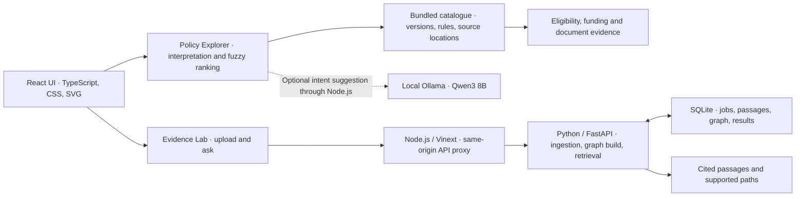
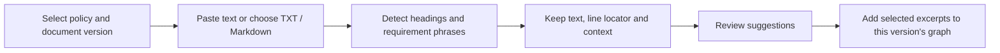
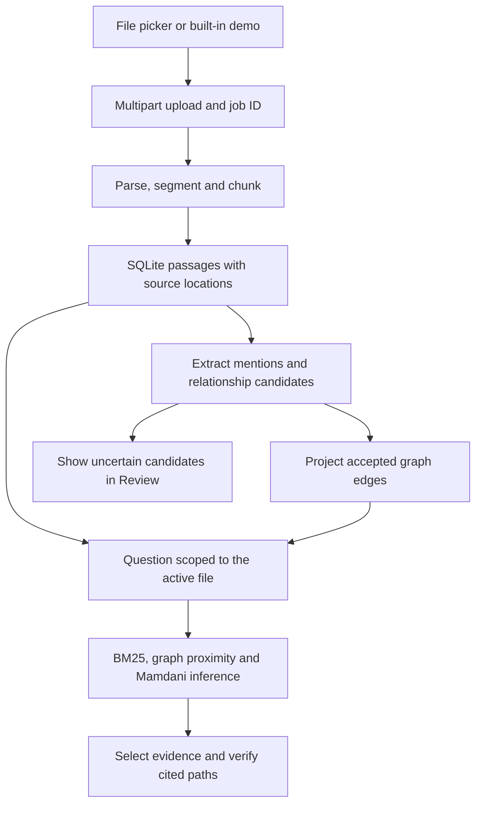
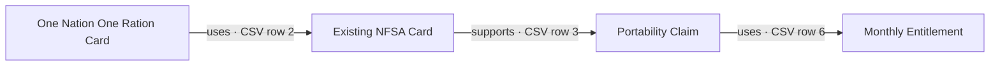

# Ration Saathi technical walkthrough

Ration Saathi has two ranking pipelines. The **Policy Explorer** ranks government schemes against a plain-language question. The **Evidence Lab** ranks passages from an uploaded document and finds connections supported by those passages. The **Eligibility & requirements** view exposes the source behind each requirement for the selected policy version.

The auto-rickshaw ranking and the CSV evidence scores in this guide come from runs of the implementation. The standalone Mamdani calculation uses chosen inputs for hand verification.

## Architecture



## 1. From a plain-language question to ranked schemes

Try **“I want to buy an auto-rickshaw. Can the government help?”** The TypeScript parser normalizes Unicode with NFKC, lowercases the text, replaces punctuation with spaces, and uses phrase rules to identify the user's goal and constraints. The relevant fields from this run are:

```json
{
  "goal": "Purchase a vehicle",
  "asset": "three-wheeler",
  "goals": ["vehicle", "three-wheeler"],
  "use": "",
  "state": "",
  "electric": false,
  "petrol": false
}
```

The question leaves location and intended use unspecified. The user can supply those details with the filters. Explicit restrictions narrow the candidate set before ranking. A petrol request, for example, excludes electric-only schemes, and an explicit state filters out schemes specific to other states.

The remaining schemes get four signals in $[0,1]$: activity fit $A$, wording $W$, location $L$, and documentation $D$.

$$
S_{\mathrm{policy}}=0.54A+0.27W+0.12L+0.07D.
$$

For wording, the search compares distinct query terms with policy keywords and the best matching rule. Each matching term contributes two points if longer than four characters, otherwise one. If $h$ is their combined score and $n$ is the number of distinct query terms, wording membership is:

$$
W=\operatorname{Trap}\!\left(h;0,\max(3,n),1000,1001\right).
$$

In the normal range it rises linearly from zero and reaches full membership at $h=\max(3,n)$. An exact scheme name gets full wording credit and takes priority in the final sort. Activity fit can also be graded, giving a broader match useful placement without equating it to a scheme that explicitly covers the named vehicle.

| Scheme returned by the current code | Activity | Wording | Location | Documentation | Score |
| --- | ---: | ---: | ---: | ---: | ---: |
| Pradhan Mantri MUDRA Yojana | 1.00 | 1.00 | 0.77 | 1.00 | **0.9724** |
| Tamil Nadu Auto-Rickshaw Purchase Subsidy | 1.00 | 1.00 | 0.43 | 1.00 | **0.9316** |
| Prime Minister’s Employment Generation Programme | 0.62 | 1.00 | 0.77 | 1.00 | **0.7672** |

Both direct vehicle matches get full activity credit. With the state unspecified, the Tamil Nadu entry receives less location credit. The activity difference explains the entire score gap between the first and third results, $0.54(1-0.62)=0.2052$. These are fixed relevance weights. The site exposes the components in **Why this programme appeared**. [Policy parser and ranker](../lib/policy/search.ts#L419)

When no goal is recognized or no matches are found, **Try local interpretation** can ask a local Ollama model for a supported intent. A Node.js route requests a structured JSON reply and validates the intent. The user can confirm the suggested search before the catalogue search runs again. Qwen3 8B is the launcher's default model when available. Programme facts and citations come from the catalogue. [Ollama route](../app/api/policy/interpret/route.ts)

## 2. From a selected policy version to eligibility evidence

A policy has one or more versions. Each version contains rules with relationship text, evidence, and an optional source override. The graph turns a selected rule into a subject, a relationship, and an object, with a source title, locator, and URL attached. Selecting a different version can change both the relationship and the source.

The **Eligibility & requirements** tab groups published criteria, exclusions, required documents, and application steps. It distinguishes **curated summaries**, **recorded source excerpts**, and **document excerpts you supplied**. For instance, an indexed MahaDBT section can yield individual requirement nodes. Selecting a node opens its recorded line and surrounding context. [Eligibility workspace](../components/ration/eligibility-workspace.tsx)



The document importer reads English text locally in the browser. It uses section and phrase patterns, including expressions such as “must,” “not eligible,” and “apply through.” The fictional demo contains an overdue-loan exclusion with an exception for a recorded repayment arrangement. Reading the whole excerpt preserves the exception. Reviewers choose which passages to add, and the added passages stay in the current tab, scoped to the policy and version. The importer accepts up to 60,000 characters and 200 candidates. PDF passages can be copied into the text field. [Extractor](../lib/policy/extract-requirements.ts) · [Fictional demo text](../public/demo/fictional-policy-excerpt.txt)

The **Money** view can illustrate a published formula where configured. For a valid project cost $c$, rate $r$, and cap $M$, the result is $\min(cr,M)$, subject to the indexed project ceiling. The result carries the source and represents an illustration of the rule. [Funding calculation](../components/ration/policy-explorer.tsx#L127)

## 3. From a file to a knowledge graph



The browser uploads the file to FastAPI via the Node.js proxy and polls the ingestion job. Python parses the file into source segments and chunks long segments. The Lab upload client defaults to 400 words with 64 words of overlap. A passage keeps a locator such as a CSV row or PDF page.

An entity is a canonical concept and a mention is an occurrence of it in a source. The rule-based extractor recognizes supported assertions such as “Cedar Sheet feeds Ivory Queue.” It stores the subject, predicate, object, evidence span, and source passage ID. The Lab requests entity and relation thresholds of 0.80 and 0.75. Explicit predicates and the absence of uncertainty or negation are checked before projecting accepted edges. The **Review** control records a browser review mark for an uncertain candidate. [Upload and build settings](../lib/ration/uploads.ts) · [Graph extraction rules](../backend/app/graph/extraction.py)

## 4. Retrieval mathematics

**BM25** uses an inverted index to find passages matching query terms. Let $N$ be the number of indexed passages, $df_t$ the number containing term $t$, $f_{t,p}$ its frequency in passage $p$, and $\ell_p/\bar\ell$ the ratio of passage length to the corpus average.

$$
\operatorname{IDF}(t)=
\ln\!\left(1+\frac{N-df_t+0.5}{df_t+0.5}\right)
$$

$$
B(p,Q)=
\sum_{t\in Q\cap p}\operatorname{IDF}(t)
\frac{2.2f_{t,p}}{f_{t,p}+1.2\left(0.25+0.75\,\ell_p/\bar\ell\right)}.
$$

Rarer terms contribute more, repeated terms have diminishing returns, and length normalization adjusts for a longer passage's chances of a match. For a nonempty query, term coverage is $C=|Q\cap p|/|Q|$. The lexical score is $X=CB/(1+B)$.

**Graph proximity** starts a breadth-first search from recognized query entities. A node at distance $d$ contributes $1/(d+1)$ to passages mentioning it, and each passage keeps the largest affinity $G$ it receives. The normal Lab request allows up to four hops and scopes the evidence to the active file. Graph neighbors can contribute passages that supply an intermediate connection even when those passages share few words with the question. Discovery can traverse edges in either direction and the displayed relations retain their original direction and type.

**Mamdani fuzzy inference** uses the normalized lexical score $X$, the strongest accepted relationship associated with the passage, and graph distance. The first input is called `semantic_similarity` in code. In this pipeline it receives the lexical proxy. Triangular and trapezoidal membership functions map the numbers to graded terms.

| Rule | Antecedent | Output set | Weight |
| --- | --- | --- | ---: |
| R1 | High match AND strong relation AND near path | Highly relevant | 1.00 |
| R2 | Medium match AND moderate relation | Relevant | 0.90 |
| R3 | Low match OR weak relation OR far path | Irrelevant | 1.00 |

AND takes the minimum antecedent membership and OR takes the maximum. Multiplying by the rule weight gives firing strength $\alpha_i$. Each rule clips its output membership curve $\mu_i$, and the maximum across those curves forms the aggregate. Centroid defuzzification samples $y_j=j/100$:

$$
\mu_{\mathrm{out}}(y)=\max_i\min\!\left(\alpha_i,\mu_i(y)\right),
\qquad
F=\frac{\sum_{j=0}^{100} y_j\mu_{\mathrm{out}}(y_j)}
        {\sum_{j=0}^{100} \mu_{\mathrm{out}}(y_j)}.
$$

With chosen inputs $X=0.70$, relationship strength $0.88$, and distance $2$, the engine evaluates high match at $0.80$, strong relation at $1.00$, and near path at $2/3$. R1 fires at $2/3$ while R2 and R3 fire at zero. The code returns a centroid of **0.900488**. The firing strength is the height used to clip the output, and the centroid is its horizontal center.

The normal ration profile uses $S_{\mathrm{lab}}=0.65X+0.20G+0.15F$. The retriever considers up to 200 shortlisted passages for fuzzy reranking. For a supported two-concept path, it can reserve bridge passages before applying the five-passage display limit. [Retrieval service](../backend/app/retrieval/service.py) · [Fuzzy inference engine](../backend/app/fuzzy/engine.py) · [Domain weights](../backend/app/domain_profiles.py#L48)

## 5. Worked file example

In Evidence Lab, run the guide demo and ask **“How is One Nation One Ration Card related to Monthly Entitlement?”** The following result was reproduced with the bundled CSV and a fresh SQLite database.



| CSV row | Lexical | Graph | Fuzzy | Hybrid |
| --- | ---: | ---: | ---: | ---: |
| 2 | 0.597392 | 1.00 | 0.891540 | **0.722036** |
| 3 | 0.228720 | 0.50 | 0.129020 | **0.268021** |
| 6 | 0.262722 | 1.00 | 0.130800 | **0.390389** |

Row 3 has the lowest score among those three rows, but it supplies the middle edge. The retriever can keep the rows together and verify the path using the selected citations. If the selected sources cannot support the requested connection, it can show related passages alongside an insufficient-evidence result. Open **How the search ranked evidence** to inspect the score contributions and rule firings. [Demo CSV](../public/demo/ration-guide.csv) · [Cited path tests](../backend/tests/test_ration_saathi.py)

## Technology and runtime

| Technology | Project role |
| --- | --- |
| React, TypeScript | Interface state, search, filters, version selection, review, and browser-side catalogue ranking |
| CSS, SVG, Lucide | Responsive layout, graph rendering, and controls that select evidence records |
| Node.js, Vinext, Vite | Web app build and service on local port 3001, same-origin API proxy, and optional Ollama route |
| Python, FastAPI, Pydantic, Uvicorn | Ingestion, graph and retrieval endpoints, request/response validation, and local API service on port 8001 |
| SQLite, Python parsers, pypdf | Store jobs, passages, graphs, and results. Evidence Lab reads TXT, Markdown, text PDF, DOCX, CSV, and JSON |
| Ollama and Qwen3 8B | Optional supported-intent classification for ambiguous policy questions |
| TypeScript, Oxlint, Node test runner, pytest, Playwright | Type checking, lint, unit tests, backend integration tests, and browser workflows |

The **Get help** screen also searches a separate curated English and Hindi guide. Its score combines 60% phrase match, 32% rarity-weighted exact word match, and 8% near-spelling match. Try `fingerprnt` for the spelling example. [Public guide search](../lib/ration/guide.ts#L61)

For a live presentation, start with the auto-rickshaw question and expand **Why this programme appeared**. Select a policy and open **Eligibility & requirements** to inspect its sources. Then run the CSV demo, click the edge backed by row 3, and show **How the search ranked evidence**. [Live demo walkthrough](POLICY_EXPLORER.md#short-presentation-walkthrough)
